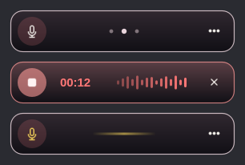
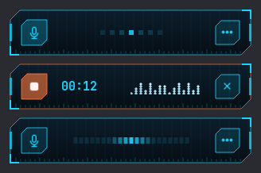
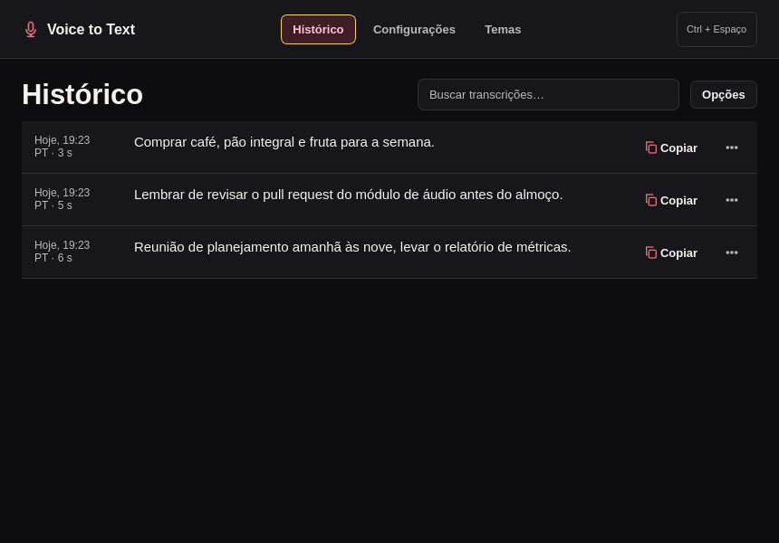
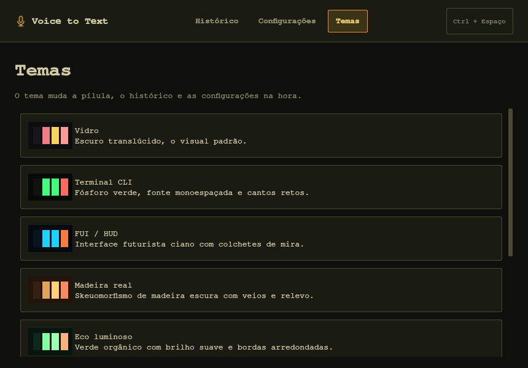

# 🎙️ Voice-to-Text (Whisper Local STT)

A modern, ultra-fast desktop application in **Python (PySide6)** that performs real-time speech-to-text transcription using the **Whisper** model (via `faster-whisper`) running 100% locally on your machine (NVIDIA CUDA GPU or CPU).

---

## 📸 Interface Demonstration

### 🎨 Themes

Pick a theme in the **Temas** tab and the whole app changes instantly. Each theme redraws the floating pill from scratch (shape, size, buttons, status indicators and waveform), not just the colors. Every image shows the pill idle, recording and transcribing.

| | |
| :---: | :---: |
| **Vidro (Glass)**: the default dark translucent pill<br> | **Terminal CLI**: a terminal window with a blinking cursor<br> |
| **FUI / HUD**: cyan sci-fi panel with targeting brackets<br> | **Madeira real (Real Wood)**: grained wood, brass knobs and screws<br> |
| **Eco luminoso (Luminous Eco)**: glowing leaves and orb buttons<br> | **Lo-fi**: a cassette tape with spinning reels<br> |
| **RPG Pixel Art**: stair-stepped dialog box and pixel icons<br> | **S.T.A.L.K.E.R.**: an old Soviet field radio with antenna, tuning dial and knurled knob<br> |

---

### 🗂️ Main Window

| Transcription History | Application Settings | Themes |
| :---: | :---: | :---: |
|  |  |  |

The same window under the **S.T.A.L.K.E.R.** theme:

| Transcription History | Themes |
| :---: | :---: |
|  |  |

*The screenshots are rendered by the app itself (offscreen), so the translucent areas show a flat backdrop. Real background blur needs the optional GNOME extension described below.*

---

## 🆕 What's New Since the Previous Version

- 🎨 **Themes tab with 8 themes**: Glass, Terminal CLI, FUI/HUD, Real Wood, Luminous Eco, Lo-fi, RPG Pixel Art and S.T.A.L.K.E.R. Choosing a card applies the theme live (pill, history, settings and menus) and saves it in the `theme` setting.
- 💊 **Pill redesigned per theme**: each theme ships its own "skin" (`src/ui/skins.py`) that paints the case, buttons, status indicators and waveform: a Soviet radio with a tuning needle, a cassette with spinning reels, a terminal with a cursor, brass knobs on wood, and so on. Size and layout change with the theme.
- 👁️ **Status is visual, not textual**: the pill no longer shows sentences. Transcribing is a glow that grows from the center of the pill, success is a check and errors are a "!". The full text stays available as a tooltip and accessible name.
- 🔘 **Flat, quiet buttons**: no more boxes around the record and "more" buttons (theme skins draw their own faces and the focus box only appears for keyboard navigation).
- 🖼️ **New app icon**: a glass pill with the record knob, a waveform, transcribed text lines and the theme colors.
- 🎙️ **Dictation and settings**: microphone selection with a "check microphone" button, dictation vocabulary (hotwords), optional review and edit before copying, an option to keep no local history, performance profiles, retry after a failed transcription, and edit/export for history items.
- 📦 **Standalone build**: `packaging/build.sh` builds a self-contained app (with the CUDA 12 runtime), installs it for the current user and adds it to the app menu.
- 🌫️ **Optional GNOME backdrop extension** (`packaging/gnome-backdrop`) to blur what is behind the pill.
- ✅ **Tests**: new UI and pipeline regression tests, including one that renders every theme in every pill state.

---

## ✨ Key Features

- ⚡ **High-Precision Local Transcription**: Uses `faster-whisper` (supports `large-v3-turbo`, `large-v3`, `small`, and `base` models).
- 🎛️ **Floating Pill**: a draggable widget with purely visual status indicators (Ready, Recording, Transcribing, Success, Error), fully reskinned by the selected theme.
- 🎨 **8 Themes**: Glass, Terminal CLI, FUI/HUD, Real Wood, Luminous Eco, Lo-fi, RPG Pixel Art and S.T.A.L.K.E.R., switchable live from the **Temas** tab.
- 📌 **Always on Top & Custom Position**: Toggle "Always on Top" with a click and save your preferred position on the screen.
- ⌨️ **Global Hotkeys (X11 & Wayland)**:
  - **X11 / Default**: Global key listening via `pynput` (`Ctrl + Space`).
  - **Wayland (Linux GNOME/KDE/Hyprland)**: Native support for triggering via UDP socket using a lightweight `wayland_trigger.py` script.
- 🧠 **Smart VRAM Management**: Options to keep the model loaded in the GPU for instant transcription or unload VRAM after a configurable idle time (5s, 15s, 30s, or immediate).
- 📋 **Auto-Copy to Clipboard**: Transcribed text is automatically copied using `QClipboard`.
- 🗃️ **History & SQLite Search**: Internal database to store the history of transcribed audio with instant text search support.
- 🔔 **System Tray Integration**: System tray icon for quick access to history and controls.

---

## 🛠️ How Each Part of the Code Works

The project is structured in a clean, modular way for easy maintenance and expansion:

| File / Module | Description & Functionality |
| :--- | :--- |
| **`main.py`** | The entry point of the application. Initializes the PySide6 application, loads QSS themes, manages the lifecycle of components (including the safe handling of VRAM cleanup timers), and connects UI signals/slots with the audio recorder, database, and transcription worker thread. |
| **`wayland_trigger.py`** | An ultra-lightweight Python script that sends a UDP packet (`TOGGLE`) to port `15324`. This allows you to bind the application shortcut directly in your OS Shortcut Settings (e.g., GNOME/KDE Wayland). |
| **`src/audio/recorder.py`** | Responsible for capturing real-time microphone audio using the `sounddevice` library in mono format (16kHz, float32). Handles recorded audio in memory through NumPy buffers. |
| **`src/db/database.py`** | SQLite database manager (`transcriptions.db`). Stores transcription history and user preferences (Whisper model, CPU/CUDA device, hotkey mode, VRAM policies). |
| **`src/engine/stt_engine.py`** | The "brain" of the application. Contains the `ModelManager` class (which loads and unloads Whisper models into VRAM/RAM) and the `TranscribeWorker` class (`QThread`), which runs transcription in the background to prevent the UI from freezing. |
| **`src/ui/floating_widget.py`** | The `FloatingPillWidget` class implements a borderless, transparent floating pill that is draggable by the user and supports the system tray (`QSystemTrayIcon`). It delegates all painting (case, buttons, status and waveform) to the active skin. |
| **`src/ui/skins.py`** | One `Skin` class per theme (glass, terminal, HUD, wood, eco, lo-fi, RPG pixel art, Stalker radio). Each defines the pill size and layout and paints its body, buttons, status indicators and waveform with `QPainter`. |
| **`src/ui/themes.py`** | Theme palettes and tokens (colors, fonts, radii) plus helpers to get and set the active theme. |
| **`src/ui/history_window.py`** | The main window with three tabs: **History** (searchable list with copy, edit, export and delete), **Settings** (microphone, language, model, device, VRAM policy, hotkey mode...) and **Temas** (theme cards that apply live). |
| **`src/ui/styles.py`** | The QSS template for the whole app; `build_qss(theme)` renders it with the colors and fonts of the chosen theme. |
| **`src/utils/hotkey.py`** | Global hotkey manager. Runs a `pynput` listener in a dedicated thread and simultaneously runs a UDP socket server on port `15324` for Wayland integration. |
| **`src/utils/injector.py`** | Utility responsible for copying the transcribed text to the OS clipboard via `QClipboard`. |

---

## 🚀 How to Install and Run

### 1. Prerequisites
- **Python**: version 3.10 or higher.
- **NVIDIA GPU** (Optional, but highly recommended for high performance): Updated NVIDIA drivers and CUDA support.

### 2. Clone the Repository and Create a Virtual Environment
```bash
git clone https://github.com/your-username/Voice-to-Text.git
cd Voice-to-Text

python3 -m venv .venv
source .venv/bin/activate
```

### 3. Install Dependencies
```bash
pip install --upgrade pip
pip install -r requirements.txt
```

### 4. Run the Application
```bash
python main.py
```

### 5. (Optional) Build a Standalone App
Builds a self-contained executable (with CUDA 12 runtime libraries bundled) and adds **Voice to Text** to your app menu, so you can launch it from the desktop search without touching Python:
```bash
packaging/build.sh
```
It installs to `~/.local/opt/voice-to-text`, adds a `voice-to-text` command to `~/.local/bin` and a desktop entry. The packaged app stores its history in `~/.local/share/voice-to-text/transcriptions.db`. Re-run the script after changing the code.

---

## Ditado e configurações

- Na aba **Configurações**, escolha o microfone e use **Verificar microfone** para confirmar que o dispositivo abre no formato de captura. Use o medidor da pílula durante o ditado para conferir o sinal.
- Em **Comportamento**, ative **Revisar e editar antes de copiar** para corrigir o resultado antes da cópia. Desative **Salvar transcrições no histórico local** para aplicar o modo sem histórico aos novos ditados.
- Use **Vocabulário do ditado** para informar nomes, siglas e termos técnicos. O motor recebe esses termos como pistas.
- Os perfis de desempenho preenchem as opções de dispositivo e modelo. Salve as configurações para aplicá-las. A primeira carga pode precisar baixar os pesos do modelo.
- Após uma falha de transcrição, use **Mais opções → Tentar transcrever novamente**. O áudio da tentativa fica em memória até iniciar outra gravação ou até fechar o app. Cada nova tentativa usa as configurações salvas.
- No histórico, **Mais** abre ações para editar ou exportar uma transcrição como texto UTF-8.

### Desfoque do fundo da pílula no GNOME

No GNOME Shell 51, a extensão **Voice to Text Backdrop** pede ao compositor
para desfocar o conteúdo por trás da pílula. O efeito acompanha as janelas
e o papel de parede. A extensão usa o papel da janela para aplicar o desfoque
somente à pílula.

```bash
gnome-extensions pack --out-dir=/tmp packaging/gnome-backdrop
gnome-extensions install /tmp/voice-to-text-backdrop@local.shell-extension.zip
```

Em uma primeira instalação, saia e entre novamente na sessão do GNOME para
que o Shell descubra a extensão. Depois, ative-a no aplicativo Extensões ou
com `gnome-extensions enable voice-to-text-backdrop@local`. A pílula usa sua
superfície translúcida em ambientes sem essa integração.

## ⌨️ Configuring Shortcuts on Linux Wayland (GNOME / KDE)

On Linux with Wayland, global hotkeys via software are usually blocked for security reasons. To fix this:

1. Open your **System Settings** -> **Keyboard** -> **Custom Shortcuts**.
2. Add a new shortcut:
   - **Name**: Transcribe Voice
   - **Command**: `python3 /path/to/Voice-to-Text/wayland_trigger.py` (standard library only — no venv needed)
   - **Shortcut**: `Ctrl + Space` (or your preferred combination).

---

## 📄 License

This project is available under the MIT license. Feel free to modify and distribute it.
