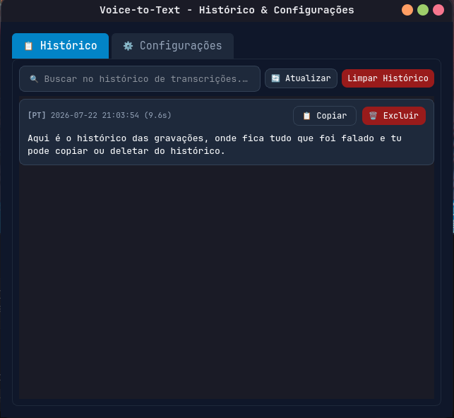
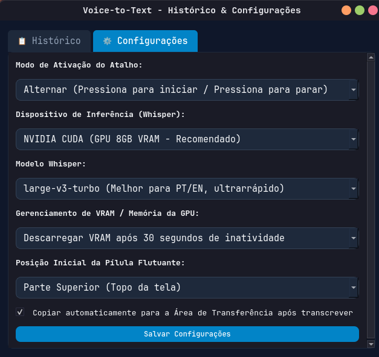

# 🎙️ Voice-to-Text (Whisper Local STT)

A modern, ultra-fast desktop application in **Python (PySide6)** that performs real-time speech-to-text transcription using the **Whisper** model (via `faster-whisper`) running 100% locally on your machine (NVIDIA CUDA GPU or CPU).

---

## 📸 Interface Demonstration

### 🎛️ Floating Pill (Interface States)

| Normal Mode (Ready) | Recording Mode | Transcribing Mode |
| :---: | :---: | :---: |
|  |  |  |

---

### 🗂️ Main Window

| Transcription History | Application Settings |
| :---: | :---: |
|  |  |

---

## ✨ Key Features

- ⚡ **High-Precision Local Transcription**: Uses `faster-whisper` (supports `large-v3-turbo`, `large-v3`, `small`, and `base` models).
- 🎛️ **Minimalist Floating Pill**: Transparent Glassmorphism-style widget with visual status indicators (Ready, Recording, Transcribing, Success, Error).
- 📌 **Always on Top & Custom Position**: Toggle "Always on Top" with a click and save your preferred position on the screen.
- ⌨️ **Global Hotkeys (X11 & Wayland)**:
  - **X11 / Default**: Global key listening via `pynput` (`Ctrl + Space`).
  - **Wayland (Linux GNOME/KDE/Hyprland)**: Native support for triggering via UDP socket using a lightweight `wayland_trigger.py` script.
- 🧠 **Smart VRAM Management**: Options to keep the model loaded in the GPU for instant transcription or unload VRAM after a configurable idle time (5s, 15s, 30s, or immediate).
- 📋 **Auto-Copy to Clipboard**: Transcribed text is automatically copied using `QClipboard`.
- 🗃️ **History & SQLite Search**: Internal database to store the history of transcribed audio with instant text search support.
- 🔔 **System Tray Integration**: System tray icon for quick access to history and controls.

---

## 🛠️ How Each Part of the Code Works

The project is structured in a clean, modular way for easy maintenance and expansion:

| File / Module | Description & Functionality |
| :--- | :--- |
| **`main.py`** | The entry point of the application. Initializes the PySide6 application, loads QSS themes, manages the lifecycle of components (including the safe handling of VRAM cleanup timers), and connects UI signals/slots with the audio recorder, database, and transcription worker thread. |
| **`wayland_trigger.py`** | An ultra-lightweight Python script that sends a UDP packet (`TOGGLE`) to port `15324`. This allows you to bind the application shortcut directly in your OS Shortcut Settings (e.g., GNOME/KDE Wayland). |
| **`src/audio/recorder.py`** | Responsible for capturing real-time microphone audio using the `sounddevice` library in mono format (16kHz, float32). Handles recorded audio in memory through NumPy buffers. |
| **`src/db/database.py`** | SQLite database manager (`transcriptions.db`). Stores transcription history and user preferences (Whisper model, CPU/CUDA device, hotkey mode, VRAM policies). |
| **`src/engine/stt_engine.py`** | The "brain" of the application. Contains the `ModelManager` class (which loads and unloads Whisper models into VRAM/RAM) and the `TranscribeWorker` class (`QThread`), which runs transcription in the background to prevent the UI from freezing. |
| **`src/ui/floating_widget.py`** | The `FloatingPillWidget` class implements a borderless (`FramelessWindowHint`), transparent floating pill widget that is draggable by the user, features a colored status indicator, and supports the system tray (`QSystemTrayIcon`). |
| **`src/ui/history_window.py`** | A modal window containing two main tabs: **History** (a searchable list of past transcriptions with copy and delete buttons) and **Settings** (comboboxes to change the model, CUDA/CPU device, VRAM policies, and hotkey modes in real-time). |
| **`src/ui/styles.py`** | QSS (Qt Style Sheets) containing the modern dark theme applied throughout the application. |
| **`src/utils/hotkey.py`** | Global hotkey manager. Runs a `pynput` listener in a dedicated thread and simultaneously runs a UDP socket server on port `15324` for Wayland integration. |
| **`src/utils/injector.py`** | Utility responsible for copying the transcribed text to the OS clipboard via `QClipboard`. |

---

## 🚀 How to Install and Run

### 1. Prerequisites
- **Python**: version 3.10 or higher.
- **NVIDIA GPU** (Optional, but highly recommended for high performance): Updated NVIDIA drivers and CUDA support.

### 2. Clone the Repository and Create a Virtual Environment
```bash
git clone https://github.com/your-username/Voice-to-Text.git
cd Voice-to-Text

python3 -m venv .venv
source .venv/bin/activate
```

### 3. Install Dependencies
```bash
pip install --upgrade pip
pip install -r requirements.txt
```

### 4. Run the Application
```bash
python main.py
```

---

## ⌨️ Configuring Shortcuts on Linux Wayland (GNOME / KDE)

On Linux with Wayland, global hotkeys via software are usually blocked for security reasons. To fix this:

1. Open your **System Settings** -> **Keyboard** -> **Custom Shortcuts**.
2. Add a new shortcut:
   - **Name**: Transcribe Voice
   - **Command**: `/path/to/.venv/bin/python /path/to/Voice-to-Text/wayland_trigger.py`
   - **Shortcut**: `Ctrl + Space` (or your preferred combination).

---

## 📄 License

This project is available under the MIT license. Feel free to modify and distribute it.
