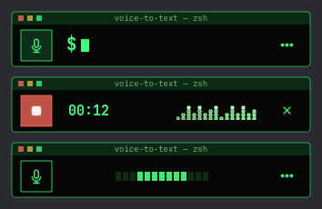
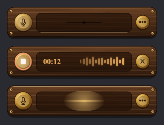
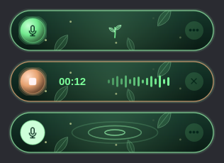
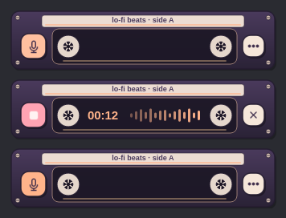
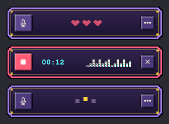
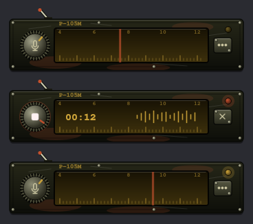
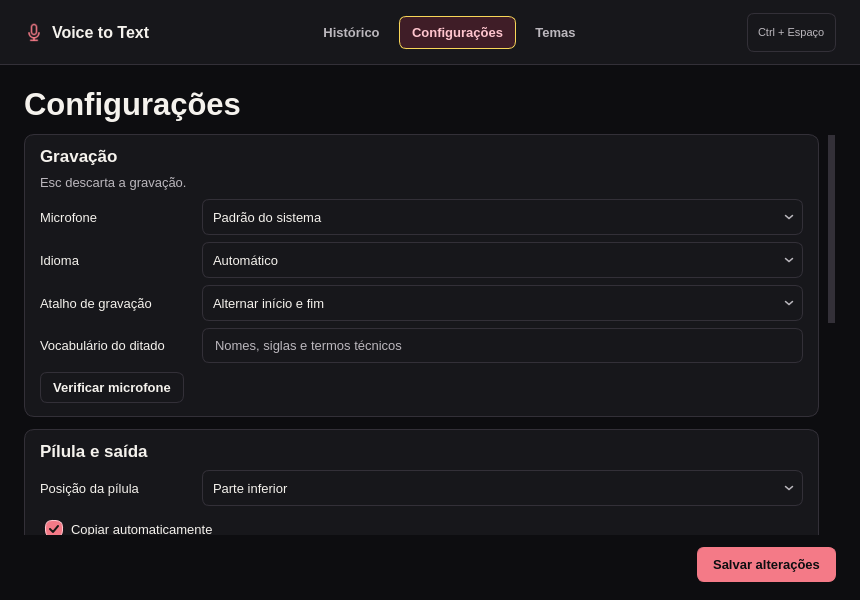
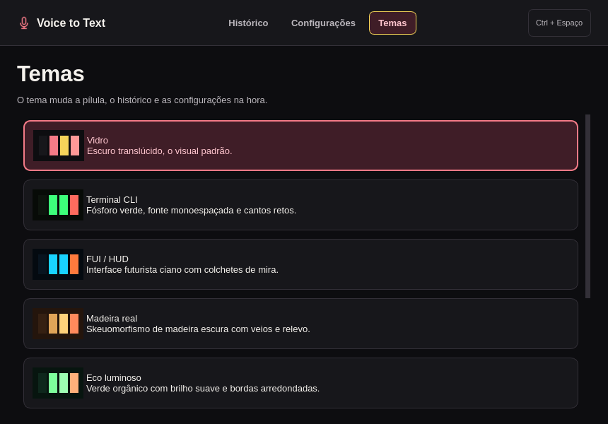
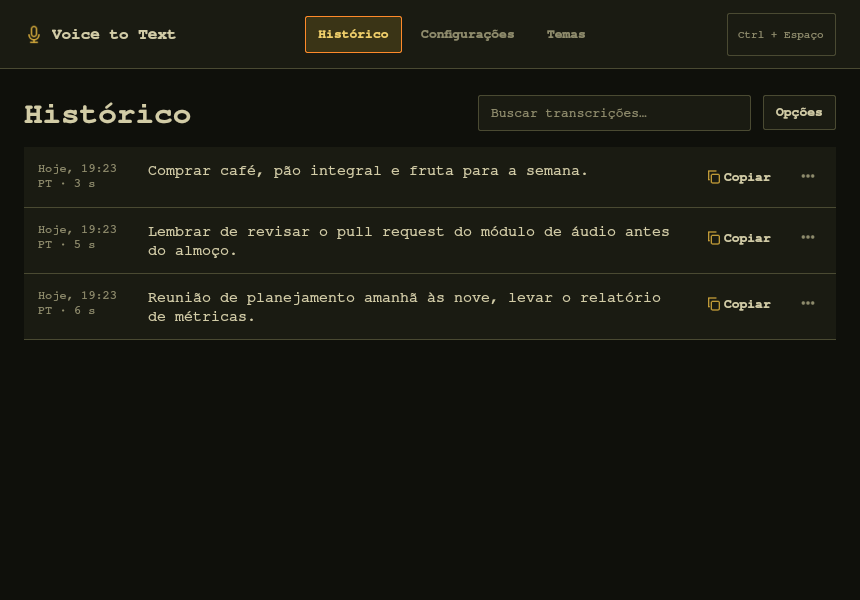

# Voice-to-Text (Local Whisper Dictation)

A desktop dictation app written in **Python (PySide6)**. Press a global hotkey, speak, and the text is transcribed by the **Whisper** model (through `faster-whisper`) running **100% locally** on your machine, on an NVIDIA GPU (CUDA) or on the CPU. Nothing is sent to the cloud.

The app lives in a small floating **pill** that you can drag anywhere. You can reskin the whole app with **8 themes**, from a glass pill to an old Soviet field radio.

> **Note:** the app's interface text is currently in Brazilian Portuguese. The code, commits and this documentation are in English.

---

## Screenshots

### Themes

Pick a theme in the **Temas** tab and the whole app changes instantly. Each theme redraws the floating pill from scratch (shape, size, buttons, status indicators and waveform), not just its colors. Every image below shows the pill **idle**, **recording** and **transcribing**, from top to bottom.

| | |
| :---: | :---: |
| **Glass**: the default dark translucent pill<br> | **Terminal CLI**: a terminal window with a blinking cursor<br> |
| **FUI / HUD**: a cyan sci-fi panel with targeting brackets<br> | **Real Wood**: grained wood with brass knobs and screws<br> |
| **Luminous Eco**: glowing leaves and orb buttons<br> | **Lo-fi**: a cassette tape with spinning reels<br> |
| **RPG Pixel Art**: a stair-stepped dialog box with pixel icons<br> | **S.T.A.L.K.E.R.**: an old Soviet field radio with antenna, tuning dial and knurled knob<br> |

### Main window

The main window has three tabs: **History**, **Settings** and **Themes**.

| History | Settings | Themes |
| :---: | :---: | :---: |
|  |  |  |

The same window under the **S.T.A.L.K.E.R.** theme:

| History | Themes |
| :---: | :---: |
|  |  |

*These screenshots are rendered by the app itself (offscreen), so translucent areas show a flat backdrop. Real background blur needs the optional GNOME extension described in the "Background blur on GNOME" section below.*

---

## Features

- **Local, private transcription**: `faster-whisper` with the `base`, `small`, `large-v3-turbo` and `large-v3` models, on CUDA or CPU.
- **Floating pill**: a draggable, frameless widget with purely visual status indicators (ready, recording, transcribing, success, error). Double-click it to open the history.
- **8 themes**: Glass, Terminal CLI, FUI/HUD, Real Wood, Luminous Eco, Lo-fi, RPG Pixel Art and S.T.A.L.K.E.R. Themes change the pill, the main window, the menus and the icons, and are applied live.
- **Global hotkey**: `Ctrl + Space` toggles recording (or hold to talk, see the settings). `Esc` discards the current recording.
- **Live waveform and timer** while recording, drawn in the style of the active theme.
- **Sound cues** when recording starts, stops or is canceled (can be turned off).
- **Microphone choice**, with a **Check microphone** button to confirm the device opens correctly.
- **Auto-copy to the clipboard**, with an optional **review and edit** step before copying.
- **History**: transcriptions are stored in a local SQLite database with instant search, edit, export to a UTF-8 text file, delete with undo, and load-more paging.
- **Dictation vocabulary**: add names, acronyms and technical terms that Whisper receives as hints.
- **Smart VRAM management**: keep the model loaded for instant transcription, or unload it after an idle time (5 s, 15 s, 30 s or immediately).
- **Performance profiles**: Fast (CPU, `base`), Balanced (`large-v3-turbo` on an NVIDIA GPU) and Precision (`large-v3` on an NVIDIA GPU).
- **Retry after a failure**: **More options → Retry transcription** reuses the audio kept in memory.
- **Always on top** and a saved pill position (bottom center, top center, or where you left it).
- **System tray icon** for quick access to the history and the recording toggle.
- **Wayland support**: global hotkeys are triggered through a tiny UDP script, since Wayland blocks global key listeners.

---

## Themes in detail

| Theme | What changes in the pill |
| :--- | :--- |
| **Glass** | Dark translucent pill with a soft rim and three beads in the middle while idle. The recording state tints the surface red. |
| **Terminal CLI** | A terminal window with a title bar and scanlines. Idle shows a `$` prompt with a blinking cursor, transcribing shows a block progress bar growing from the center, and results appear as `OK` or `ERR`. Buttons are bracketed squares. |
| **FUI / HUD** | A cyan sci-fi panel with chamfered corners, targeting brackets and a ruler along the bottom. Buttons are angular plates, the waveform is made of LED segments and transcribing is a scanning segmented bar. |
| **Real Wood** | A wooden plank with grain, a knot, bevelled edges and brass screws. The record and menu buttons are brass knobs, and the status area is an engraved recess with an amber backlit waveform. |
| **Luminous Eco** | A rounded capsule with leaves, fireflies and a green glow. Buttons are glowing orbs, idle shows a small sprout and transcribing sends ripples out from the center. |
| **Lo-fi** | A cassette tape with a label, screws and two reels that spin while recording or transcribing. Buttons look like pastel stickers. |
| **RPG Pixel Art** | A dialog box with stair-stepped corners and no anti-aliasing. Buttons are beveled pixel keys, idle shows pixel hearts, transcribing shows bouncing pixels, and success and error are a pixel star and a pixel cross. |
| **S.T.A.L.K.E.R.** | An old Soviet field radio: antenna, olive metal case with rivets, rust and scratches, and a stenciled model label. The record button is a knurled rotary knob, cancel and menu are metal plates, the status area is a backlit tuning dial with a red needle that sweeps while transcribing, and a lamp shows the state (amber, green or red). |

The theme you choose is saved in the database (`theme` setting) and restored the next time the app starts.

---

## What's new since the previous version

- **Themes tab with 8 themes**, applied live to the pill, history, settings and menus.
- **The pill is redrawn per theme**: each theme has its own "skin" (`src/ui/skins.py`) that paints the case, buttons, status indicators and waveform. Size and layout change with the theme.
- **Status is visual, not textual**: the pill no longer shows sentences. Transcribing is a glow that grows from the center of the pill, success is a check mark and errors are an "!". The full text is still available as a tooltip and as the accessible name.
- **Flat, quiet buttons**: no more boxes around the record and "more" buttons. Each skin draws its own button faces, and the focus box only appears when you navigate with the keyboard.
- **New app icon**: a glass pill with the record knob, a waveform, lines of transcribed text and the theme colors.
- **Dictation and settings**: microphone selection and check, dictation vocabulary, optional review before copying, an option to keep no local history, performance profiles, retry after a failure, and edit/export for history items.
- **Standalone build**: `packaging/build.sh` builds a self-contained app (with the CUDA 12 runtime), installs it for the current user and adds it to the app menu.
- **Optional GNOME backdrop extension** (`packaging/gnome-backdrop`) that blurs what is behind the pill.
- **Tests**: new UI and pipeline regression tests, including one that renders every theme in every pill state.

---

## How the code is organized

| File / module | What it does |
| :--- | :--- |
| **`main.py`** | Entry point. Creates the `QApplication`, applies the saved theme, wires the UI signals to the recorder, the database and the transcription worker, and manages the VRAM idle timer. |
| **`wayland_trigger.py`** | A tiny, standard-library-only script that sends a UDP packet (`TOGGLE`) to port `15324`. Bind it to a keyboard shortcut in your desktop settings on Wayland. |
| **`src/audio/recorder.py`** | Captures microphone audio with `sounddevice` (mono, 16 kHz, float32) into NumPy buffers and emits the live volume level. |
| **`src/audio/audio_cues.py`** | Plays the start, stop and cancel sound cues. |
| **`src/db/database.py`** | SQLite manager (`transcriptions.db`). Stores the transcription history and every user setting (model, device, hotkey mode, VRAM policy, theme...). |
| **`src/engine/stt_engine.py`** | `ModelManager` loads and unloads Whisper models in VRAM/RAM, and `TranscribeWorker` (a `QThread`) transcribes in the background so the UI never freezes. |
| **`src/ui/floating_widget.py`** | `FloatingPillWidget`: the frameless, draggable pill with system tray support. It delegates all painting (case, buttons, status and waveform) to the active skin. |
| **`src/ui/skins.py`** | One `Skin` class per theme. Each defines the pill size and layout and paints its body, buttons, status indicators and waveform with `QPainter`. |
| **`src/ui/themes.py`** | Theme palettes and design tokens (colors, fonts, radii) plus helpers to get and set the active theme. |
| **`src/ui/styles.py`** | The QSS template for the whole app. `build_qss(theme)` renders it with the colors and fonts of the chosen theme. |
| **`src/ui/history_window.py`** | The main window with three tabs: **History**, **Settings** and **Themes**. |
| **`src/utils/hotkey.py`** | Global hotkey manager: a `pynput` listener in a dedicated thread plus a UDP server on port `15324` for Wayland. |
| **`src/utils/injector.py`** | Copies the transcribed text to the clipboard through `QClipboard`. |
| **`packaging/`** | `build.sh` and the PyInstaller spec for the standalone app, and the optional GNOME backdrop extension. |
| **`tests/`** | Regression tests for the pipeline, the UI and the themes. |

---

## Installation

### 1. Prerequisites

- **Linux** with Python 3.10 or newer (developed and tested on GNOME/Wayland).
- An **NVIDIA GPU** with up-to-date drivers is optional but strongly recommended. Without one the app runs on the CPU.

### 2. Clone the repository and create a virtual environment

```bash
git clone https://github.com/Rafaleel/local-speech-to-text.git
cd local-speech-to-text

python3 -m venv .venv
source .venv/bin/activate
```

### 3. Install the dependencies

```bash
pip install --upgrade pip
pip install -r requirements.txt
```

### 4. Run from source

```bash
python main.py
```

The first transcription may need to download the Whisper model weights, so it can take a while.

### 5. (Optional) Build and install a standalone app

This builds a self-contained executable (with the CUDA 12 runtime libraries bundled) and adds **Voice to Text** to your app menu, so you can launch it from the desktop search without touching Python:

```bash
packaging/build.sh
```

It installs the app to `~/.local/opt/voice-to-text`, adds a `voice-to-text` command to `~/.local/bin`, installs the icon and creates a desktop entry. The packaged app keeps its history in `~/.local/share/voice-to-text/transcriptions.db`.

**To update the installed app after changing the code, run `packaging/build.sh` again, then close the running app and open it again.** The installer does not stop a running instance.

Use `packaging/build.sh --no-install` to only build, without installing.

---

## Using the app

1. Open the app. The pill appears on screen (bottom center by default).
2. Press **`Ctrl + Space`** (or click the microphone button) to start recording, and press it again to stop. In *hold to talk* mode, keep the keys pressed while you speak.
3. Press **`Esc`** (or the **X** button) while recording to discard it.
4. When you stop, the audio is transcribed. The text is copied to the clipboard and saved in the history.

Pill controls:

- **Left button**: starts or stops recording.
- **Right button**: while idle it opens the menu (History, Settings, always on top, quit, and error details or retry after a failure). While recording it becomes **X** to discard.
- **Drag** anywhere on the pill to move it. **Double-click** to open the history.

### Settings

- **Recording**: choose the microphone and use **Check microphone** to confirm that the device opens in the capture format. Pick the language, the hotkey mode (toggle or hold to talk) and the **dictation vocabulary** (names, acronyms and technical terms that are passed to Whisper as hints).
- **Pill and output**: choose where the pill appears, copy automatically after transcribing, **review and edit before copying**, save transcriptions in the local history (turn this off for a no-history mode that applies to new dictations) and enable or disable sound cues.
- **Performance**: pick a profile (Fast, Balanced or Precision) that fills in the device and model for you.
- **Advanced**: choose the device (CPU or CUDA), the Whisper model and the VRAM policy. Keeping the model loaded reduces the wait between transcriptions.

Click **Save changes** to apply the settings. Theme changes in the **Temas** tab apply immediately and do not need saving.

### History

Search is instant. Each entry can be copied, edited or exported as a UTF-8 text file from the **...** menu, and deleted with an undo option. **Options → Clear history** removes everything.

### If a transcription fails

Use **More options → Retry transcription** on the pill. The audio of the attempt stays in memory until you start another recording or close the app. Each retry uses the current saved settings.

---

## Keyboard shortcuts on Wayland (GNOME / KDE)

On Linux with Wayland, software global hotkeys are usually blocked for security reasons. To work around it, bind a system shortcut to the trigger script:

1. Open **System Settings → Keyboard → Custom Shortcuts**.
2. Add a new shortcut:
   - **Name**: Transcribe Voice
   - **Command**: `python3 /path/to/Voice-to-Text/wayland_trigger.py` (standard library only, no virtual environment needed)
   - **Shortcut**: `Ctrl + Space` (or any combination you prefer)

The script sends a `TOGGLE` packet to the app over UDP (`127.0.0.1:15324`).

---

## Background blur on GNOME (optional)

A Qt application can make its window translucent, but on GNOME it cannot ask the compositor to blur what is behind it. The optional **Voice to Text Backdrop** extension does that for the pill only, so the translucent themes get a real frosted-glass look. It targets **GNOME Shell 51**.

```bash
gnome-extensions pack --out-dir=/tmp packaging/gnome-backdrop
gnome-extensions install /tmp/voice-to-text-backdrop@local.shell-extension.zip
```

On a first installation, log out and back in so GNOME Shell discovers the extension. Then enable it in the **Extensions** app or with:

```bash
gnome-extensions enable voice-to-text-backdrop@local
```

Without the extension, the pill simply uses its translucent surface.

---

## Running the tests

```bash
source .venv/bin/activate
pip install pytest
QT_QPA_PLATFORM=offscreen python -m pytest tests -q
```

The tests run the UI offscreen. One of them builds the stylesheet for every theme and renders the pill in every state (idle, settling, recording, transcribing, review, success and error) to make sure no theme breaks.

---

## Adding a theme

1. Add a palette to `_THEMES` in `src/ui/themes.py` (colors, font, radii and a `style` name).
2. Create a `Skin` subclass in `src/ui/skins.py` that sets the pill size and paints the body, buttons, status and waveform, and register it in `SKINS` under the same `style` name.
3. The new theme appears automatically as a card in the **Temas** tab.

---

## License

No license file is included yet. Add one before redistributing.
